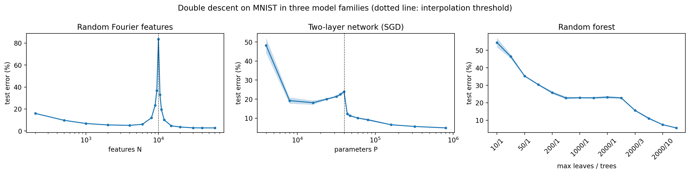

# Reproducing "Reconciling Modern Machine-Learning Practice and the Classical Bias–Variance Trade-off"

CMP4509 Introduction to Deep Learning, term project.

We reproduce the **double descent** risk curve of Belkin, Hsu, Ma & Mandal (2019), [PNAS 116(32)](https://doi.org/10.1073/pnas.1903070116) / [arXiv:1812.11118](https://arxiv.org/abs/1812.11118), on MNIST with four model families, using free Google Colab resources and PyTorch.

**Claim tested.** For models trained with the squared loss, test risk as a function of model capacity follows a double descent curve: the classical U-shape below the *interpolation threshold* (the smallest capacity that fits the training data exactly), a peak at the threshold, and a second descent beyond it that ends below the best under-parameterised model. Beyond the threshold, the norm of the learned solution decreases.

## Results at a glance



Mean ± standard deviation over 3 seeds. Paper values are read from the paper's figures (≈).

| Experiment (paper figure) | Best below threshold | At the threshold | Largest model | Paper (≈) |
|---|---|---|---|---|
| Random Fourier features, n = 10,000 (Fig. 2) | 5.09 ± 0.21 % (N = 4,000) | **83.62 ± 1.09 %** (N = n) | **2.76 ± 0.07 %** (N = 60,000) | 4.5 % / 88 % / 2.5 % |
| Two-layer MLP, n = 4,000, weight reuse (Fig. 4) | 18.1 ± 1.1 % (P ≈ 16k) | **23.9 ± 0.8 %** (P = nK = 40k) | **4.88 ± 0.06 %** (P ≈ 800k) | 13 % / 21 % / 4.5 % |
| Two-layer MLP, n = 4,000, no weight reuse (Fig. 9c) | decreases monotonically up to P = nK | 11.0 ± 0.4 % at P = nK; small bump to 12.2 ± 1.0 % just above | 4.87 ± 0.06 % | modest bump |
| Random forest, n = 10,000 (Fig. 5) | 22.7 % (500 leaves) | 23.2 % (one interpolating tree) | **5.6 %** (20 trees) | 22.5 % / 23 % / 6 % |

Values are test zero-one error. Further results:

- **RFF:** the coefficient norm peaks at N = n (2,922 ± 490) and decreases towards the kernel limit; kernel-limit norm 61.2 ± 0.5 (paper: 62), kernel-limit test error 2.52 ± 0.03 %.
- **Two-layer MLP:** with weight reuse, a clear peak at P = nK (test squared loss 0.77 ± 0.06, training error 0.8 %). Without weight reuse the peak almost disappears (a bump of about one seed-std just above P = nK), but large interpolating networks still beat the best under-parameterised one (11.0 % → 4.9 %). The peak height therefore depends strongly on the optimisation procedure; the second descent does not.
- **Random forest:** test squared loss (÷ 10, see deviations) 0.0366 → peak 0.0463 at interpolation → 0.0145 with 20 trees (paper ≈ 0.036 / 0.046 / 0.015).
- **1-D random ReLU features (Fig. 3):** both N = 40 and N = 4,000 interpolate 10 points; the minimum-norm fit with N = 4,000 is smoother and has a smaller norm (162.5 vs 236.7; paper ≈ 159 vs 695 on different data).

Full paper-vs-ours tables are in `figures/final/table_*.csv` (and `.tex` for the report).

## Repository structure

```
notebooks/
  01_rff_mnist.ipynb        Random Fourier features, min-norm least squares (paper Fig. 2)
  02_mlp_mnist.ipynb        Two-layer MLP trained with SGD (paper Fig. 4 / 9)
  03_relu_1d.ipynb          1-D random ReLU features, smoothness of interpolants (paper Fig. 3)
  04_random_forest.ipynb    Random forests without bootstrap (paper Fig. 5)
  05_make_figures.ipynb     Final figures and paper-vs-ours tables from the result CSVs
results/                    One CSV per experiment (one row per trained model and seed)
figures/                    Figures saved by each notebook
figures/final/              Final figures and tables used in the report and presentation
```

## How to run

All notebooks run top to bottom on the **free tier of Google Colab** (or Kaggle). No local installation is needed: Colab already provides PyTorch, torchvision, scikit-learn, pandas and matplotlib, and MNIST is downloaded automatically.

1. Open a notebook in Colab: **File → Upload notebook**, or use the "Open in Colab" badge at the top of each notebook on GitHub.
2. Select the runtime: **Runtime → Change runtime type**. Use **T4 GPU** for notebooks 01 and 02, **CPU** for 03, 04 and 05.
3. Each notebook mounts Google Drive and writes its results to `MyDrive/double-descent/` (`results/`, `checkpoints/`, `figures/`). The folders are created automatically if they do not exist.
4. Run **Runtime → Run all**. Notebooks 01, 02 and 04 start with `PILOT = True` (small, fast check). Set `PILOT = False` in the first code cell for the full experiment.
5. Run notebook 05 last. It reads the CSVs from `double-descent/results/` (`MODE = "drive"`), or lets you upload them by hand (`MODE = "upload"`).

**Interrupted sessions.** Every finished model is appended to the result CSV immediately (notebook 02 also saves the network weights). Re-running all cells skips finished models and continues where the run stopped.

| Notebook | Runtime | Full-run time (approx.) |
|---|---|---|
| 01 RFF | T4 GPU | 30 min (3 seeds, 18 values of N) |
| 02 MLP | T4 GPU | 3 h per setting (3 seeds, 14 widths, 6,000 epochs) |
| 03 1-D ReLU | CPU | 10 s |
| 04 Random forest | CPU | a few minutes |
| 05 Figures | CPU | < 1 min |

To run several notebooks in parallel, use separate Colab sessions (separate notebook copies or accounts). Do not let two sessions append to the same CSV at the same time.

## What each notebook does

**01: Random Fourier features.** n = 10,000 MNIST training images (pixels scaled to [0, 1], one-hot labels), test on the full 10,000-image test set. Features φ(x) = √(2/N) cos(vᵀx + b) with v ~ N(0, σ⁻²I), σ = 5, b ~ U[0, 2π]. Output weights are the minimum-norm least-squares solution A = Φ⁺Y, computed in float64 through the eigendecomposition of the smaller Gram matrix (ΦᵀΦ for N < n, ΦΦᵀ for N ≥ n), without any regularisation. N ranges from 200 to 60,000, densely sampled around N = n. Also computes the Gaussian kernel limit h_{n,∞}.

**02: Two-layer neural networks.** n = 4,000. Networks 784 → H (ReLU) → 10 with P = 785H + 10(H + 1) parameters; the interpolation threshold is expected at P ≈ nK = 40,000 (H ≈ 50). Squared loss on one-hot targets, SGD with momentum 0.95, up to 6,000 epochs (paper Appendix C.3). Below the threshold: weight reuse (each network starts from the trained smaller one; new weights ~ N(0, 0.01)), step size decayed by 10 % every 500 epochs, training stopped at zero training classification error. Above the threshold: Glorot initialisation, fixed step size, 6,000 epochs. `WEIGHT_REUSE = False` reproduces the setting of paper Fig. 9c. Logs the number of dead ReLU units per network.

**03: 1-D random ReLU features.** 10 points, features max(v₁x + v₂, 0)/√N with (v₁, v₂) uniform on the unit circle, minimum-norm fit for N = 40 and N = 4,000, plus the median norm over 20 feature draws.

**04: Random forests.** n = 10,000, `RandomForestRegressor` on one-hot labels, `bootstrap=False`, `max_features="sqrt"`. Capacity is increased first by the maximum number of leaves of a single tree (10 → 2,000), then by averaging 2–20 trees with 2,000 leaves (paper Appendix D).

**05: Final figures.** Reads all result CSVs and produces the final figures (with the paper's key values marked), an overview figure, and paper-vs-ours tables as CSV and LaTeX.

## Differences from the paper

| Notebook | Difference | Reason |
|---|---|---|
| 01 | Real cosine features instead of complex exponentials e^{i⟨v,x⟩} | Keeps the threshold at N = n; kernel-limit norm matches the paper (61.2 vs 62) |
| 01 | 3 seeds (paper: 1 run) | Course requirement |
| 01–04 | Test set = full MNIST test set | Not stated in the paper |
| 02 | Learning rate 0.001 with the squared loss summed over outputs | Not stated in the paper. 0.01 killed most hidden units of freshly initialised networks. Equivalent to Keras' MSE (mean over outputs) at its default learning rate 0.01; the paper used Keras |
| 02 | Linear learning-rate warmup over the first 1,600 steps | Freshly initialised networks lost ~50 % of their hidden units in the first ~80 steps; warmup affects ~1 % of training |
| 02 | Batch size 128 | Not stated in the paper |
| 02 | 14 network widths (paper: ~20) | Compute budget; same range of P |
| 03 | Our own 10 data points (y = 3 sin(1.5x) + x + noise) | The paper does not give its data |
| 04 | Squared loss divided by 10 when compared with the paper | The paper's Fig. 5 appears to average the loss over the 10 outputs; ours sums |

All hyperparameters that the paper does not state were chosen on training error (and dead-unit counts) only, never on the test set.

## Reproducibility

- Seeds 0, 1, 2 fix the training subset, the random features / initialisation and the data order.
- Notebook 03 is fully deterministic; its outputs should match exactly (norms 236.74 and 162.51).
- Results are reported as mean ± standard deviation over seeds.

## Team

- Berk Olçay
- Kerem Kızılkale
- Gözde Korkut

## Use of AI tools

Code was written with the assistance of Claude (Anthropic). All experiments were run, checked and interpreted by the group; see the report for details.

## Citation

```bibtex
@article{belkin2019reconciling,
  title   = {Reconciling modern machine-learning practice and the classical bias--variance trade-off},
  author  = {Belkin, Mikhail and Hsu, Daniel and Ma, Siyuan and Mandal, Soumik},
  journal = {Proceedings of the National Academy of Sciences},
  volume  = {116},
  number  = {32},
  pages   = {15849--15854},
  year    = {2019},
  doi     = {10.1073/pnas.1903070116}
}
```
